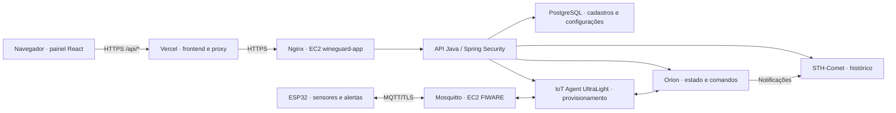

# WineGuard

Projeto acadêmico de uma equipe de quatro integrantes para monitorar temperatura, umidade e luminosidade em ambientes de armazenamento de vinhos. O ESP32 publica medições via MQTT/TLS, o FIWARE mantém o estado atual e o histórico, e o painel consulta os dados e envia comandos pela API Java.

**Painel publicado:** [wineguard-peach.vercel.app](https://wineguard-peach.vercel.app/).

O acesso exige conta fornecida pela equipe; não existe cadastro público. A API depende das instâncias do laboratório AWS ativas e de certificado HTTPS válido. O site estático na Vercel pode abrir mesmo quando a API ou o ESP estão indisponíveis.

## Estado da entrega

O fluxo painel → API Java → FIWARE/MQTT → ESP foi validado manualmente. Frontend e backend já estão reunidos neste repositório, com seus históricos Git preservados. A consolidação do firmware e da infraestrutura FIWARE/MQTT ainda está em andamento.

| Componente | Disponibilidade |
|---|---|
| [frontend/](frontend/) | React, Vite, telas, testes e configuração Vercel |
| [backend/](backend/) | API Java, PostgreSQL/Compose, migrações, testes e documentação |
| Firmware ESP32 | Funciona na integração testada; código final e instruções ainda não incorporados |
| Infraestrutura FIWARE/MQTT | Funciona na AWS; arquivos e instruções de reprodução ainda não incorporados |

Os modelos Nginx, systemd e renovação de certificados da API estão em [backend/deploy/](backend/deploy/). Eles não substituem os arquivos da infraestrutura FIWARE/MQTT.

## Arquitetura



O PostgreSQL guarda usuários, ambientes, dispositivos, limites e acompanhamento das configurações. As leituras atuais vêm do Orion; o histórico permanece no STH-Comet, com persistência MongoDB na infraestrutura FIWARE.

O navegador usa rotas relativas `/api/`. Na Vercel, [frontend/vercel.json](frontend/vercel.json) encaminha essas chamadas à API HTTPS da AWS. O proxy de desenvolvimento do Vite é separado. O navegador não acessa diretamente MQTT, Orion ou STH-Comet.

## Funcionalidades e permissões

- Login por sessão, identificação do perfil, logout e CSRF nas escritas.
- ADMIN cadastra contas USER e acessa todos os dispositivos.
- USER acessa somente os dispositivos que cadastrou. Acesso direto a sensor de outra conta retorna 404.
- Ambientes continuam compartilhados; o isolamento por proprietário se aplica aos dispositivos e suas operações.
- Novas contas USER incluem nome e localização da vinícola. Todos os usuários autenticados veem o mapa de localizações, sem dados dos sensores de outras contas.
- Leituras atuais, histórico, limites por métrica, provisionamento e remoção.
- Alertas manuais e configuração completa do ESP, com revisão, confirmação e reenvio explícito da mesma revisão.

As rotas legadas `/api/sensors` e `/api/sensors/*` estão bloqueadas com 404 no Nginx em HTTP e HTTPS. O painel utiliza as rotas Java protegidas.

Cadastro e provisionamento no IoT Agent são etapas distintas. Provisionar não cria credenciais ou ACLs MQTT. Remover um dispositivo não revoga automaticamente essas credenciais nem apaga o histórico STH.

## Sensores e configuração

O firmware utiliza ESP32, BME680 e LDR, com display, LEDs e buzzer. Temperatura usa °C; umidade usa %. Luminosidade é ADC bruto de 0 a 4095, sem calibração em lux. Medição de fumaça não faz parte do escopo.

Salvar um limite por métrica no PostgreSQL não configura o ESP. O envio completo usa revisão e estados `PENDING`, `APPLIED`, `REJECTED` e `UNCONFIRMED`. Aceitação HTTP não comprova execução física. Os parâmetros dos testes são de bancada, não faixas operacionais aprovadas para conservação de vinhos.

O comando remoto `normal` encerra o alerta remoto; não deve cancelar uma condição local persistente. Consulte o [contrato de configuração do ESP](backend/docs/configuracao-do-esp.md).

## Executar os componentes

### Frontend

Requisitos: Node.js e npm compatíveis com as dependências, além de acesso à API para dados reais. Na pasta `frontend/`, copie `.env.example` para `.env.local` e configure `VITE_API_JAVA_TARGET` com o endereço da API.

```bash
cd frontend
npm ci
npm run dev
```

Consulte [frontend/README.md](frontend/README.md) para variáveis, cookies, contratos e publicação. Mantenha sessão e CSRF tanto no desenvolvimento quanto na publicação HTTPS.

### Backend

Requisitos: JDK 17, Docker com Compose e acesso às dependências FIWARE para operações de integração. Na pasta `backend/`, copie `.env.example` para `.env`, ajuste as conexões e inicie o PostgreSQL:

```bash
cd backend
docker compose up -d postgres
```

Configure as variáveis no processo Java antes de iniciá-lo: Spring Boot não lê automaticamente `.env`. Os passos para Linux/Bash, Windows/IDE, Maven Wrapper e criação inicial de usuários estão em [backend/README.md](backend/README.md).

Flyway aplica V1–V8 na inicialização. Não altere migrações já aplicadas nem remova o volume PostgreSQL para atualizar o código. A preparação da conta ADMIN é uma operação administrativa do ambiente; não há promoção pública de usuários.

## Testes e evidências

Dentro de `frontend/`:

```bash
npm run lint
npm test
npm run build
```

Dentro de `backend/`:

```bash
./mvnw test
./mvnw clean package
```

No Windows, use `mvnw.cmd` no lugar de `./mvnw`.

Na validação de 29/10/2026, passaram **59 testes do frontend**, com HTTP simulado, e **77 testes do backend**, incluindo regras de serviço e segurança de controladores com dependências simuladas. Essas suítes não exigem ESP ou FIWARE ativos e não substituem testes físicos, consultas JPA reais ou concorrência do PostgreSQL.

Foram verificados manualmente: login ADMIN/USER, sessão após recarga, logout, restrições de acesso, mapa compartilhado, salvamento de limite com CSRF pela Vercel, alerta físico de temperatura, comando `normal`, recuperação da revisão 2 e telemetria da configuração após o reinício solicitado do ESP. A revisão 2 permaneceu aplicada após recarregar o painel.

- [Evidências da Vercel e do ESP](backend/docs/testes-vercel-esp.md).
- [Postman e evidências de execução parcial](backend/docs/postman/README-postman.md).
- [Implantação da API e HTTPS](backend/deploy/README.md).
- [Migrações, rotas e contratos](backend/README.md).

## Próximas etapas

- Incorporar firmware final, dependências, ligações e instruções sem credenciais.
- Incorporar Compose e modelos FIWARE/MQTT, provisionamento e assinaturas para reprodução do ambiente.
- Concluir as operações Postman ainda não executadas, incluindo seu novo cadastro de usuário.
- Conferir documentos antigos, requisitos da faculdade, divisão de autoria e roteiro da apresentação com os quatro integrantes.

O repositório ainda não contém tudo para reproduzir a infraestrutura e o hardware do zero. A integração operacional testada e a consolidação dos arquivos são etapas distintas.

## Credenciais e arquivos locais

Não versione `.env`, `.env.local`, senhas, tokens, cookies, chaves privadas ou exportações Postman com credenciais. Use os arquivos de exemplo e mantenha segredos no ambiente de execução. Endereços públicos do painel e da API não são credenciais.
