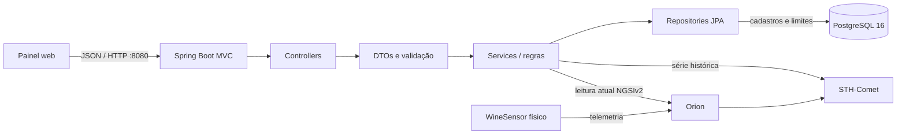

# API WineGuard

Base local: `http://localhost:8080`. A API guarda cadastros e limites no PostgreSQL; leituras atuais e históricas são consultadas nos serviços FIWARE já existentes.

## Fluxo de chamadas



## Rotas

| Método | Rota | O que faz | Respostas esperadas |
|---|---|---|---|
| `GET` | `/actuator/health` | Verifica disponibilidade da API | `200` |
| `GET` | `/api/environments` | Lista ambientes cadastrados | `200` |
| `POST` | `/api/environments` | Cria ambiente | `201`, `400` validação, `409` nome repetido |
| `GET` | `/api/devices` | Lista sensores associados a ambientes | `200` |
| `POST` | `/api/devices` | Registra dispositivo FIWARE | `201`, `400` validação, `404` ambiente inexistente, `409` duplicado |
| `GET` | `/api/devices/{deviceId}/limits` | Lista limites do sensor | `200`, `404` dispositivo inexistente |
| `PUT` | `/api/devices/{deviceId}/limits` | Cria ou atualiza limite por métrica | `200`, `400` regra inválida, `404` dispositivo inexistente |
| `GET` | `/api/devices/{deviceId}/readings/current` | Consulta atributos atuais no Orion | `200`, `404`, `502` Orion indisponível |
| `GET` | `/api/devices/{deviceId}/readings/history/{metric}` | Busca intervalo no STH-Comet | `200`, `400` intervalo inválido, `404`, `502` STH indisponível |

`metric` aceita `TEMPERATURE`, `HUMIDITY` ou `LUMINOSITY`. Os parâmetros de data devem ser instantes ISO-8601 em UTC, como `2026-10-27T00:00:00Z`, com `dateFrom` anterior a `dateTo`.

## Exemplos JSON

Criar ambiente (`POST /api/environments`):

```json
{
  "name": "Adega principal",
  "description": "Ambiente monitorado da vinícola"
}
```

Criar dispositivo (`POST /api/devices`):

```json
{
  "name": "WineGuard 002",
  "fiwareId": "wine002",
  "fiwareType": "WineSensor002",
  "fiwareService": "vinheria",
  "fiwareServicePath": "/",
  "environmentId": 1
}
```

Salvar limite (`PUT /api/devices/1/limits`):

```json
{
  "metric": "TEMPERATURE",
  "minimumValue": 10.000,
  "maximumValue": 18.000,
  "unit": "°C"
}
```

Os números do limite são só exemplo e não definem um padrão operacional para a adega. A equipe deve confirmar unidades e faixas reais dos sensores.

## Coleção Postman

Importe `docs/postman/WineGuard-API.postman_collection.json` no Postman (**Import → Files**). A coleção cobre os nove endpoints e agrupa as chamadas na ordem de demonstração: saúde, ambientes, dispositivos, limites e leituras. O Runner atualiza automaticamente os IDs criados durante a execução; as chamadas de criação usam identificadores fictícios únicos e geram registros locais a cada execução.

As leituras FIWARE ficam por último e podem retornar `502` se Orion/STH-Comet não estiverem acessíveis. A coleção documenta esse resultado como indisponibilidade de integração, não como leitura válida. Não execute a coleção repetidamente num banco que não deve receber novos cadastros de demonstração.

## O que não fica no PostgreSQL

As leituras não são copiadas para esta base: estado atual vem do Orion e o histórico vem do STH-Comet. O retorno `502 Bad Gateway` nos testes locais significa que o endpoint FIWARE configurado não estava acessível; os testes de cadastro e limites não dependem desses serviços.
