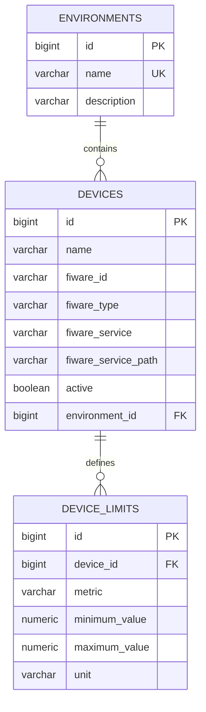

# Modelo PostgreSQL

## Diagrama



## Tabelas e restrições

| Tabela | Campos | Regras |
|---|---|---|
| `environments` | `id`, `name`, `description` | Nome obrigatório e único. |
| `devices` | `id`, `name`, `fiware_id`, `fiware_type`, `fiware_service`, `fiware_service_path`, `active`, `environment_id` | Ambiente obrigatório; ID do contexto FIWARE único dentro do service e service path. Índice por ambiente. |
| `device_limits` | `id`, `device_id`, `metric`, `minimum_value`, `maximum_value`, `unit` | Um limite por dispositivo e variável; variável restrita a `TEMPERATURE`, `HUMIDITY`, `LUMINOSITY`; mínimo ou máximo obrigatório; mínimo não pode superar máximo. |

Os campos e constraints estão definidos em `src/main/resources/db/migration/V1__create_application_schema.sql`. Flyway registra e aplica versões de migração uma vez por banco. Os dados fictícios locais ficam separados em `src/main/resources/db/seed/demo-data.sql` e não são executados automaticamente.

## Por que o Beekeeper mostra mais de 200 entidades?

O número do navegador lateral conta objetos internos do próprio PostgreSQL, não apenas tabelas criadas pelo WineGuard. `pg_catalog` contém metadados internos (índices, tipos, permissões e outros objetos) e `information_schema` oferece uma visão padronizada desses metadados. Eles pertencem ao sistema do banco e não devem ser apagados nem copiados como tabelas da aplicação.

Confirme somente as tabelas do schema `public` com esta consulta no Beekeeper:

```sql
SELECT tablename
FROM pg_tables
WHERE schemaname = 'public'
ORDER BY tablename;
```

Na instalação local, ela lista `device_limits`, `devices`, `environments` e `flyway_schema_history`: três tabelas de negócio e uma tabela de controle de migrações. O modelo está enxuto para o escopo atual; separar dispositivos e limites em tabelas diferentes mantém a relação um-para-muitos e permite validar unicidade e faixa no próprio banco. Não há duplicação de telemetria nem tabela de usuário sem contrato de autenticação definido.

Não existe tabela de histórico de medições porque o projeto já consulta o STH-Comet. Também não foi criado cadastro de usuários: o método de autenticação e os campos exigidos pelo painel precisam ser definidos com a equipe antes de persistir contas ou credenciais.
