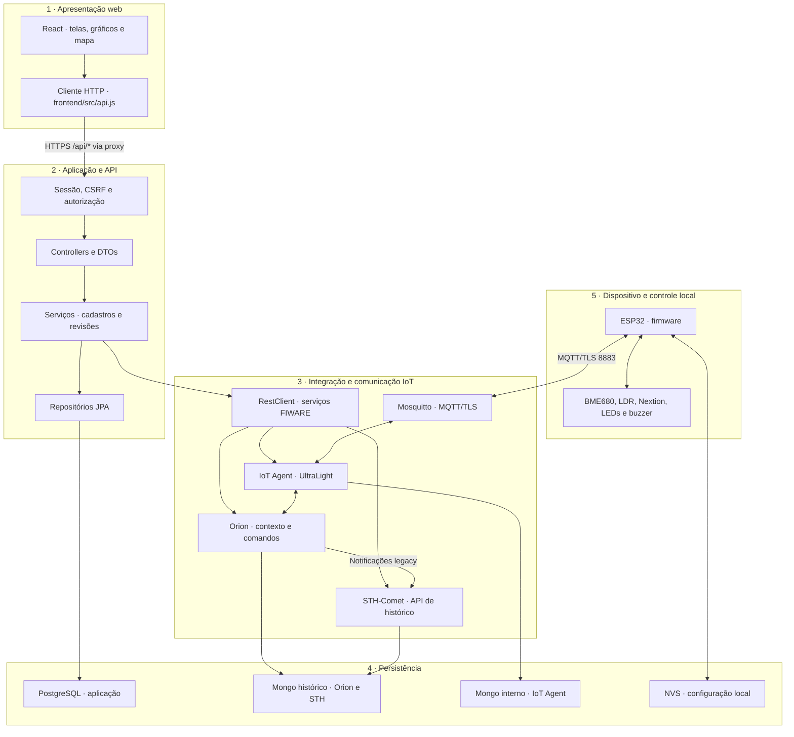

# Arquitetura em camadas — WineGuard

O WineGuard separa interface, regras da aplicação, integração IoT, persistência e execução no dispositivo. Esta descrição corresponde ao código reunido no repositório e ao fluxo validado em 29/10/2026. As instruções para reproduzir cada componente estão nos respectivos READMEs.

## Visão lógica

| Camada | Componentes | Responsabilidade |
|---|---|---|
| 1. Apresentação web | React, formulários, gráficos, mapa e cliente HTTP | Interação do usuário, validação de entrada para a tela, consultas periódicas e apresentação de resultados/erros |
| 2. Aplicação e API | Spring Security, controllers, DTOs e serviços Java | Autenticação, autorização, cadastros, limites, revisões e coordenação das operações |
| 3. Integração e comunicação IoT | Clientes FIWARE, Orion, IoT Agent UltraLight, Mosquitto e STH-Comet | Transporte, tradução UltraLight/NGSIv2, estado de contexto, comandos e histórico |
| 4. Persistência | PostgreSQL, dois MongoDB e NVS do ESP | Armazenar cadastros, estado FIWARE, histórico e configuração local, conforme a responsabilidade de cada banco |
| 5. Dispositivo e controle local | ESP32, BME680, LDR, Nextion, LEDs e buzzer | Medir, avaliar condições locais com histerese, executar comandos, mostrar estado e publicar telemetria |

As camadas representam responsabilidades. Um produto pode participar de mais de uma: o STH-Comet oferece a API de histórico e utiliza MongoDB; o ESP controla o hardware e persiste a configuração em NVS.

## Organização interna da API Java

Na camada de aplicação, os pacotes delimitam transporte HTTP, regras e acesso a dados:

| Pacote | Papel e exemplos |
|---|---|
| `config` | Segurança, identidade autenticada, propriedades e clientes HTTP |
| `controller` | Recebe requisições, valida DTOs e retorna códigos/respostas HTTP |
| `dto` | Contratos de entrada/saída, sem devolver entidades JPA completas ou hashes de senha |
| `service` | Regras de cadastro, propriedade de dispositivos, revisões, tentativas e remoção |
| `repository` | Consultas e bloqueios necessários nas transações PostgreSQL |
| `model` e `enums` | Entidades, estados e operações sobre os dados da aplicação |
| `integration/fiware` | Leitura Orion/STH, comandos, provisionamento e interpretação das mensagens do ESP |
| `common` | Exceções e conversão de falhas conhecidas em respostas consistentes |

O fluxo usual passa por controller → service → repository ou cliente FIWARE. Há também consultas específicas: [WineryMapController](../backend/src/main/java/br/com/vinhariaagnello/wineguard/controller/WineryMapController.java) usa uma projeção do repositório para retornar somente localizações. A descrição não pressupõe que todos os controllers tenham uma classe de serviço intermediária.

As chamadas de configuração ao FIWARE acontecem fora das transações de reserva de tentativa. PostgreSQL e FIWARE não compartilham uma transação distribuída; uma falha de comunicação pode deixar uma operação parcialmente concluída.

## Distribuição dos dados

| Armazenamento | Dados mantidos |
|---|---|
| PostgreSQL | Contas/perfis/localização, ambientes, dispositivos/proprietários, limites por métrica, configurações e tentativas |
| Mongo histórico autenticado | Estado do Orion e coleções históricas do STH-Comet, na topologia observada |
| Mongo interno | Registro do IoT Agent; sem porta publicada no modelo versionado |
| NVS do ESP | Revisão e cinco limites ativos em um registro com CRC32 |

As medições não são duplicadas no PostgreSQL. O nome do serviço Mongo histórico não significa que ele seja exclusivo do STH. O [Compose FIWARE](../infra/fiware/docker-compose.yml) documenta essa distribuição. O PostgreSQL é iniciado pelo [Compose do backend](../backend/docker-compose.yml).

## Fluxos de operação

### Medição e gráfico histórico

1. O ESP lê BME680 e LDR, atualiza os alertas locais e publica UltraLight em `/<chave>/<deviceId>/attrs`, incluindo `cfg` com a configuração ativa.
2. Mosquitto entrega a publicação ao IoT Agent; ele traduz `t`, `h`, `l` e `cfg` para os atributos registrados no Orion.
3. A assinatura Orion notifica o STH em `http://sth-comet:8666/notify`, com temperatura, umidade e luminosidade em formato `legacy`.
4. O navegador pede leitura atual ou histórico à API Java do dispositivo selecionado, com sua sessão.
5. A API verifica o acesso ao dispositivo. Para o histórico, [FiwareReadingsService](../backend/src/main/java/br/com/vinhariaagnello/wineguard/integration/fiware/FiwareReadingsService.java) consulta a API do STH-Comet na porta 8666, usando intervalo e contexto FIWARE.
6. O [cliente HTTP do frontend](../frontend/src/api.js) converte a resposta STH em pontos e o React desenha o gráfico. A implementação consulta 24 horas e a primeira página de até 20 registros; não promete a série inteira nem os vinte mais recentes.

O consumo da API 8666 ocorre pelo backend. O navegador mantém a mesma origem do painel; não é necessário abrir o STH diretamente para a internet.

### Alerta remoto e controle local

1. O usuário seleciona e envia um comando no painel.
2. A API valida sessão, CSRF, dispositivo e acesso; o serviço de comando envia o atributo correspondente ao Orion.
3. O IoT Agent encaminha o comando via MQTT para o tópico do dispositivo.
4. O ESP interpreta o comando e atualiza seu estado remoto, LEDs, buzzer e display.

HTTP 202 significa aceitação para envio; a confirmação física foi observada separadamente pela equipe. O comando `normal` encerra os alertas remotos. Condições locais ainda ativas permanecem controladas pelo firmware.

A versão atual avalia anomalias localmente no ESP e oferece envio manual remoto no frontend. O LED vermelho fica aceso durante o alerta; o firmware não implementa piscamento temporizado. Essas características e o escopo das adaptações aprovadas estão registrados na [matriz do Check Point](aderencia-checkpoint.md).

### Configuração com revisão e recuperação

1. O frontend envia os cinco limites completos. Salvar apenas um limite de cadastro por métrica não configura o ESP.
2. A API verifica o acesso, registra uma revisão e reserva a tentativa no PostgreSQL.
3. O comando `configure` percorre Orion → IoT Agent → MQTT → ESP.
4. O ESP valida a revisão e os valores, grava e confere a NVS, ativa a configuração e publica o resultado em `/ul/<chave>/<deviceId>/cmdexe`.
5. A telemetria também publica os valores ativos em `cfg`. O frontend acompanha a revisão por GETs sequenciais; não repete o POST automaticamente.
6. Na consulta, a API reconcilia o registro com o Orion. `APPLIED` exige coincidência de protocolo, revisão e cinco valores; `configure_status=OK` sozinho não basta.
7. Sem confirmação no prazo, o estado pode ficar `UNCONFIRMED`. O reenvio explícito preserva a revisão e os valores e consulta o estado antes de decidir enviar novamente.

O acompanhamento e a avaliação de prazo ocorrem nas consultas; não há tarefa periódica de reconciliação no backend desta versão. Um erro de rede não prova que o comando deixou de chegar ao ESP. Consulte o [contrato de configuração](../backend/docs/configuracao-do-esp.md).

## Identidade e limites de acesso

- ADMIN administra contas e acessa todos os dispositivos; USER acessa seus próprios dispositivos. Os cadastros de ambientes permanecem compartilhados.
- O backend associa o proprietário à conta autenticada e verifica o acesso nas operações; ocultar controles no React não substitui essa verificação.
- Localizações de vinícolas são compartilhadas entre usuários autenticados por uma projeção que não retorna conta ou sensores.
- Sessão usa cookie `HttpOnly`, `Secure` e `SameSite=Lax`; o React mantém CSRF em memória para as escritas.
- Banco e serviços FIWARE ficam na rede necessária à aplicação. O modelo FIWARE limita MQTT anônimo à rede Docker e publica MQTT/TLS para o ESP.
- Credenciais Wi-Fi/MQTT, senhas de banco e material TLS ficam nos arquivos locais descritos nos manuais; os modelos não contêm esses valores reais. A chave do grupo deve coincidir entre a configuração da infraestrutura, a API e os tópicos do `.ino`. O sketch importado ainda traz as constantes do ambiente testado, que precisam ser adaptadas para outra instalação.

As rotas Express legadas de sensores estão bloqueadas com 404 em HTTP e HTTPS. O modelo Nginx ainda tem fallback para o serviço legado, mas ele não é o caminho utilizado para as leituras e o histórico do painel atual.

## Implantação física

| Local | Componentes |
|---|---|
| Navegador | Interface React e cookie da sessão do site |
| Vercel | Arquivos estáticos do frontend e rewrite de `/api/*` para a API HTTPS |
| EC2 `wineguard-app` | Nginx, API Java em loopback 8080, PostgreSQL em loopback 5432 e Express legado em loopback 3000 |
| EC2 FIWARE | Orion, STH, IoT Agent, Mosquitto e dois MongoDB em containers |
| ESP32 | Firmware, sensores/atuadores, display e configuração NVS |

Vercel e Nginx encaminham requisições; autenticação e regras de negócio continuam na API Java. O trajeto entre Vercel e Nginx usa HTTPS; na EC2 da aplicação, o Nginx encaminha ao Java por HTTP de loopback. O ESP usa MQTT/TLS; o IoT Agent conversa com o broker pela rede Docker interna.

O [diagrama principal](../README.md#arquitetura) apresenta o fluxo entre componentes. Esta página complementa aquele desenho com responsabilidades lógicas. O [guia de implantação](../backend/deploy/README.md) descreve Nginx, systemd e certificado; o [guia FIWARE](../infra/fiware/README.md) descreve os modelos da infraestrutura.

## Evidência e reprodução

O fluxo remoto, os perfis e a aplicação da revisão 2 têm [evidências manuais](../backend/docs/testes-vercel-esp.md). A validação estrutural do Compose e os testes offline não comprovam a inicialização de uma stack nova. A compilação reproduzível do firmware ainda depende de versões e arquivos do hardware informados pelo responsável.

Para a entrega, associar a descrição em camadas aos códigos, manuais e demonstração. Nomes completos/divisão da equipe, Wokwi, vídeo, encapsulamento e pendências específicas continuam na [matriz de aderência](aderencia-checkpoint.md); a documentação de arquitetura não comprova sozinha esses itens.
