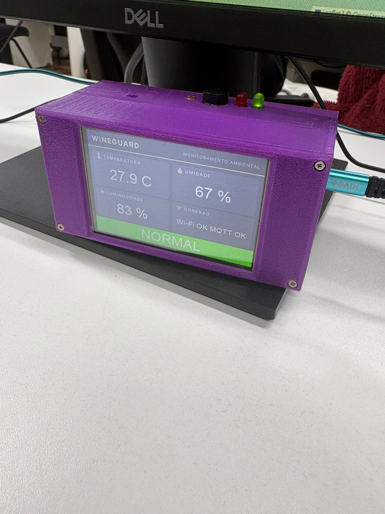
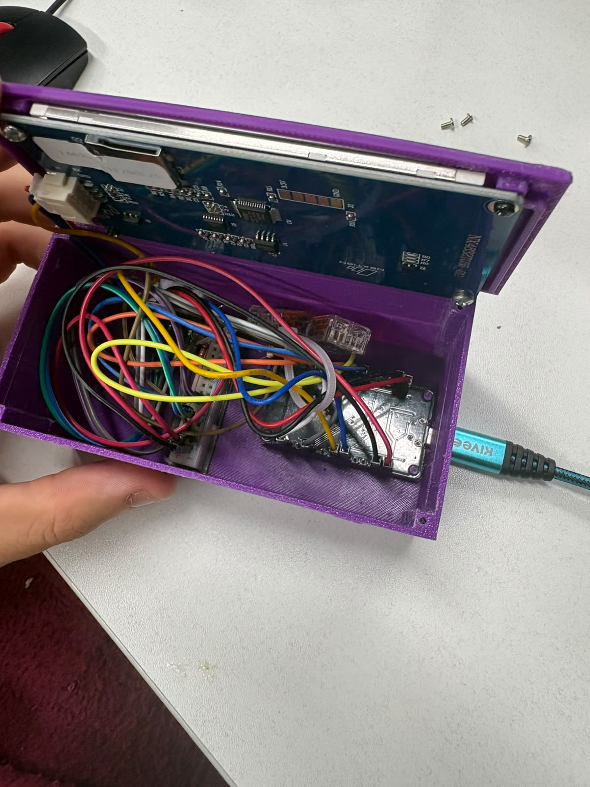

# Fotografias do protótipo WineGuard

Fotografias fornecidas pela equipe em 30/10/2026. A data de envio não determina a data da captura.

## Vista frontal e encapsulamento

A foto mostra a caixa roxa fechada, fixação por parafusos, display frontal, componentes de sinalização na parte superior e conexão USB lateral. O display apresenta temperatura de 27,9 °C, umidade de 67%, luminosidade relativa de 83%, mensagens “Wi-Fi OK MQTT OK” e estado “NORMAL”. São valores registrados na fotografia, não uma consulta atual à API. O LED verde aparece aceso.

Esta imagem documenta o acabamento e a interface local em funcionamento no instante fotografado. Sozinha, não comprova toda a comunicação com o FIWARE, piscamento, padrões sonoros ou a qualidade elétrica da montagem.

## Vista interna

A vista interna mostra o verso do display preso à tampa, a placa de desenvolvimento, protoboard e fiação dentro da caixa. Os detalhes visuais não permitem validar todas as conexões ou identificar com segurança cada módulo sob os cabos.

As duas fotografias são evidências da montagem e do encapsulamento físico. Não substituem o esquema elétrico, a lista de componentes e os arquivos `.HMI`/`.TFT` do Nextion.

## Outros materiais

A equipe informou que a apresentação e o vídeo já estão concluídos. O vídeo será encaminhado diretamente pelo Forms, conforme orientação da equipe; não é necessário publicar seu link neste repositório. A existência do vídeo foi informada pelo usuário e não verificada por estas fotografias.
